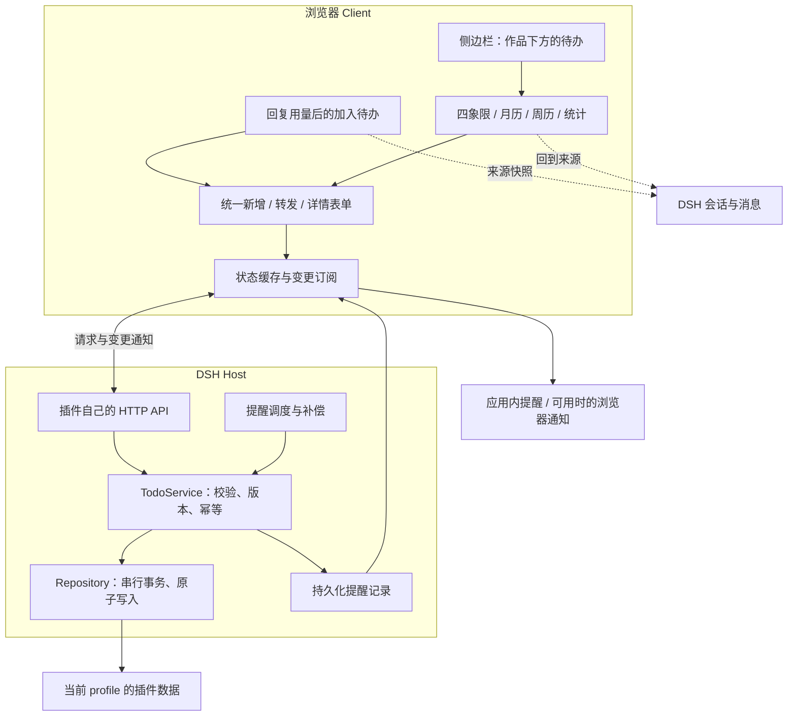

# DSH Follow-up 插件架构

版本：v1 · 2026-11-19 · 实施设计

## 1. 产品定位

这是用户自己的想法收集和后续跟进工具。输入包括手动记录的想法，以及与 Agent 交流后仍需由用户推进的事项。会话是来源上下文；完成与否由用户决定。

核心闭环：**收集 → 整理轻重缓急 → 安排日期 → 提醒 → 推进 → 完成**。

第一版实现手动新增、会话转发、收集箱、四象限、月历、周历、统计列表、详情编辑、完成/撤销完成、删除、来源跳转、可选提醒。第一版不注册 Agent 工具，不调用模型，不创建 Agent 执行任务，不引入运行中/执行失败等状态。

设计依据：[Figma Page2](https://www.figma.com/design/OvCXm8qENJ1PHUbcAxQSbj/Untitled?node-id=20-2)。实现读取当前设计，不改动画布。节点：home `20:6`、月 `23:140`、周 `23:489`、统计 `23:597`、转发 `23:4`、详情 `23:1122`。

## 2. 总体结构

采用一个可安装的 Cordis 插件包，包含浏览器 Client 和 Node Host 两个入口。没有独立云服务。



## 3. 模块与边界

| 模块 | 负责什么 | 不负责什么 |
| --- | --- | --- |
| `client/views` | 四种视图的展示、筛选、日期导航 | 写磁盘、独立维护待办副本 |
| `client/editor` | 新增、转发确认、编辑详情；复用字段 | 自动替用户生成执行计划 |
| `client/dsh` | 正式 slot、主面板、会话定位、按钮位置适配 | 领域状态、私有 Electron API |
| `core` | 类型、输入校验、日期/象限/统计选择器 | React、网络、文件系统 |
| `host/service` | 创建、更新、完成、删除、幂等、冲突 | 视图布局 |
| `host/repository` | 持久化、恢复、迁移、互斥 | UI 状态 |
| `host/reminders` | 计算触发点、持久化事件、重启补偿 | 启动 Agent 或执行任务 |

视图切换、当前日期、展开的详情属于 Client 状态。待办内容、完成状态、提醒设置属于 Host 状态。保存成功只在落盘成功后返回。

## 4. DSH 集成决策与版本证据

开发目标为本机 Desktop 打包的 **DSH 0.2.2-rc.3**。本机另有 `0.1.2-rc.1` 的 CLI/共享 node_modules，不把它当成桌面版当前运行时。开发首先验证目标包，而不是复制旧社区插件的依赖列表。

### 4.1 侧边栏与主内容区

当前桌面运行时提供 `sidebar.panellist` 和 keyed `main` 扩展链。注册唯一面板 ID `dsh-followup`，显示名为「待办」，主面板用同一 key。按实际「作品」entry 的 order 排在它后面；用户自行调整或取消固定导航时尊重宿主行为。

不替换 sidebar、conversation、根布局等 single slot。旧版不支持正式面板扩展时报告版本不兼容，不退化为接管整个聊天区。已经安装的 `dsh-quadrant-todo`、`dsh-todo-inbox` 保留各自数据和路由；隔离验证避免三个「待办」混淆。

### 4.2 回复操作栏

使用 `conversation.chat.assistant-actions` 获得当前 `sessionId` 与完成回复的 `messageId`，以正式会话投影读取来源。仅已完成且有稳定消息 ID 的回复支持转发。

已读桌面版实现：操作栏顺序为复制 → 插件扩展项 → 分支 → 用量 → 时间。因此 slot 的 order 不能把按钮排到用量之后。

将位置处理封装在 `AssistantActionPlacementAdapter`：只对本插件拥有的挂载节点做受控定位，在已验证的操作栏结构中放到用量之后、时间之前。点击、焦点顺序和卸载恢复均要验证；结构未知时保留可用的正式 slot 并报告位置不兼容。不复制或替换宿主整段操作栏。未来宿主提供 placement contract 时可仅替换这个文件。

### 4.3 来源会话

点击转发时固定来源身份与文本快照，再打开表单；切换会话不改变已打开草稿的来源。快照来自消息投影，不从 DOM 猜消息身份。

保存：`scopeId + workspaceId? + sessionId + messageId + seq? + sessionTitle + excerpt`。`scopeId` 是本 profile 插件数据的持久身份，不以 URL/端口或显示名称代替。`seq` 仅在 SDK 能证明其与该消息对应时保存。

保留有限引用文本，不拷贝整段历史，不复制附件、工具输出和凭据。标题由用户确认，默认取回复首个有效文本行，可编辑；不调用模型。

从待办点击来源：通过正式工作区/会话服务打开会话，支持定位时定位到消息；不支持精确定位则打开会话并显示保存的引用。来源被删时待办仍可读、可编辑、可完成，提示来源不可用。

## 5. 数据模型

```ts
type Priority = 'inbox' | 'urgent' | 'urgent-important' | 'neither' | 'important';
type Due = null
  | { kind: 'date'; date: string }
  | { kind: 'time'; at: string; timeZone: string };
type Reminder = 'none' | 'at-due' | 'before-10m';

interface Todo {
  id: string;
  title: string;
  note: string;
  priority: Priority;
  status: 'open' | 'done';
  due: Due;
  reminder: Reminder;
  source: null | {
    scopeId: string;
    workspaceId?: string;
    sessionId: string;
    messageId: string;
    seq?: number;
    sessionTitle: string;
    excerpt: string;
  };
  createdAt: string;
  updatedAt: string;
  scheduleUpdatedAt: string; // 只在提醒计划变化时更新
  completedAt: string | null;
  deletedAt: string | null;
  version: number;
  scheduleVersion: number;
}
```

约束：

- 标题必填，最长 200 字；备注最长 10,000 字；来源引用最长 2,000 字。均按普通文本渲染。
- 收集箱表示尚未分类，与完成状态、有没有日期独立。全部、待办、已完成是状态筛选；收集箱是分类筛选。
- 紧急和重要由用户设置，不因为日期接近自动改象限。逾期是派生标记，不新增任务状态。
- 快速新增默认「收集箱、无日期、不提醒」。从象限的加号新增预设该象限；从日历新增预设日期。
- 转发默认进收集箱；如果用户在确认表单选定象限，则保存到所选象限。按钮文案跟随结果，避免“选择重要且紧急却显示保存到收集箱”的歧义。
- 日期型是日历日期；时间型保存 UTC 瞬时与 IANA 时区，显示按看板时区投影。不能用 UTC 截取替代本地日期。
- 提醒只对明确时间启用。仅日期时，用户先补充时间；不暗中指定 09:00。
- 完成/删除会撤销未触发提醒。重新打开已经过时的事项不突然弹出旧提醒，用户重新安排时间后才恢复提醒。

## 6. 存储与一致性

第一版选择 **原子 JSON 存储 + Host 单写者队列**。个人本地待办体量小，避免 SQLite 原生依赖与 Electron/Node ABI 适配。`Repository` 接口保留将来迁移 SQLite 的空间。

文件位于已解析的当前 profile 数据目录：`data/dsh-followup/state.json`。Desktop 通过启动器公开的 `profileContext.dir` 获取 profile 根目录；普通 Web 通过显式 `dataDir` 配置，或显式环境变量 `DSH_FOLLOWUP_DATA_DIR`。环境变量用于隔离测试，不推断 Desktop profile。

状态文件包含 `schemaVersion`、持久 `scopeId`、全局 `revision`、todos、提醒 outbox 和有限的 requestId 结果缓存。所有变更在一次事务内完成；`temp → flush → rename` 后发布通知。先发布再落盘会制造“看似保存成功”的数据丢失，因此禁止。

只允许一个 Host 持有同一目录的写锁。锁持有者消失后可回收，但不能按短超时强行抢走仍活跃的 Host。损坏文件保留原件并停止写入，使用上一份校验通过的备份恢复；不能静默清空。

每条记录使用 `version` 防止两个窗口覆盖；全局 `revision` 用于刷新与断线恢复。schema 迁移先备份。卸载插件保留数据。

## 7. 插件 API 与同步

以下路径已由本插件实现，不是 DSH 内置 API：

| 路径 | 用途 |
| --- | --- |
| `GET /dsh-followup/api/state` | 当前 snapshot、scopeId、revision、提醒状态 |
| `POST /dsh-followup/api/command` | create / update / complete / reopen / delete / dismiss-reminder |
| `GET /dsh-followup/api/events` | SSE revision 通知；支持断线后重取 snapshot |
| `POST /dsh-followup/api/notification-claim` | 单窗口领取系统通知投递权 |

命令包含 `requestId`、`expectedVersion`（修改已有记录时）、payload。重复 requestId 返回同一结果；同一 requestId 对应不同 payload 则拒绝。网络重试不会重复创建。

同一来源的再次转发返回原记录以便继续编辑，避免不知情重复保存。删除后可以重新收集。需要从同一回复拆多项以后再增加明确操作。

Host 验证请求、字段、大小、身份范围与版本。使用宿主 connection 的访问校验，路径按宿主提供的 base URL 解析，兼容 Desktop scheme 和子路径代理，不放开跨域。

SSE 只负责通知“revision 已变”；客户端拿到 snapshot 后只采用同 scope 且更大的 revision。首次连接先订阅并在连接建立后刷新，关闭首次读取与订阅之间的竞态；重连总是重取，第一版无需维护无限事件日志。

## 8. 四种视图共用规则

共用 `BoardToolbar`、`TodoCard`、`TodoEditor` 和纯选择器，禁止各自实现不同的日期/状态规则。

| 视图 | 日期语义 | 内容 |
| --- | --- | --- |
| 紧急程度 | 默认全部日期；可筛选指定日期 | 保持设计的 2×2 顺序：紧急不重要、重要且紧急、不重要不紧急、重要不紧急 |
| 月视图 | 当前月，周一开头，含相邻月补齐日格 | 依 due 所在日期展示；未安排日期独立保留 |
| 周视图 | 当前周，周一至周日 | 纯日期放全天栏；精确时间放时间轴；每项是时间点，不捏造执行时长 |
| 统计列表 | 当前月 | 总数、未完成、已完成、完成率与可点开的表格 |

统计第一版是“所选范围内待办的当前状态”，不是历史执行绩效：有日期按 due 纳入范围，无日期在「未安排日期」中保留并计入当前列表。四个数字来自同一集合，完成率 = 已完成 / 总数；状态筛选只筛表格，不把「已完成」筛选错误地算成 100%。空集合显示 0%。界面展示范围口径。

## 9. 提醒

默认不提醒；到期时和提前 10 分钟由用户选。紧急重要可以强化视觉，但不擅自打开通知。

Host 每隔约 15 秒扫描，同时在加载、任务更改后重算最近触发点。定时器只是唤醒机制，磁盘记录才是事实。修改日期/提醒、完成和删除会增加 `scheduleVersion`，撤销旧计划。

触发键：`todoId + scheduleVersion + triggerAt`。到点时与待办状态一起校验，在一个事务中持久化 outbox，随后通知客户端。多窗口共享一条应用内提醒；系统通知通过有期限的领取权减少重复。浏览器投递成功 ACK 与 claim 分开，失败可重试；浏览器/操作系统不提供严格 exactly-once，崩溃窗口可能重复，但已触发事件不会丢失。

休眠/重启后：24 小时以内的过时提醒汇入应用内提醒；只对最近 15 分钟内的事件尝试弹系统通知，更早的显示为错过提醒，避免重新打开时大量弹窗。已完成和已删的记录不补发。

保证范围：Host 活着时可以生成持久提醒；没有 UI 时先保留事件。UI 活着且获得权限时可用 Browser Notification。没有经验证的公开原生通知服务前，不依赖 `desktopRuntime`、Electron 私有 API，不承诺完全退出 DSH 或电脑休眠时准点通知。应用内提醒入口始终可用。

## 10. 前端技术

- TypeScript + React，使用宿主共享 React 实例，构建时 external，避免重复 React。
- 使用 shadcn 官方 registry 的组件源码（MIT），在仓库内维护，结合 Radix 与 scoped CSS。shadcn 是源码分发，不是运行时 `shadcn/ui` CDN。
- 图标使用 lucide-react，只将使用到的图标构建进产物，保留 currentColor。
- Figma 已读白底、#FAFAFA 内容底、#E4E4E7 边框、6–10px 圆角及四象限点缀色；映射为插件 CSS 变量并兼容宿主深色主题。不向 document 注入全局 reset。
- 开发预览复用生产 Host service 与生产 UI，fixture 只代替宿主导航与会话，不代替待办存储。

## 11. 生命周期与文件组织

```text
dsh-followup/
  ARCHITECTURE.md
  DEVELOPMENT_PLAN.md
  package.json / cordis.patch.yml
  src/
    core/          # model, validation, dates, selectors
    host/          # service, repository, routes, reminders
    client/
      dsh/         # slots, source adapter, action placement
      views/       # quadrants, month, week, statistics
      components/  # toolbar, card, editor, reminders
      api.ts / store.ts / styles.css
    index.ts       # Host entry
    client.tsx     # browser entry
  scripts/         # build, isolated preview
  tests/           # domain, persistence, transport, adapter integration
  output/          # package and visible verification evidence
```

加载时解析 profile → 获取存储锁 → 验证/迁移 → 注册路由 → 启动调度。Client 注册 slots → 连接状态 → 渲染。卸载时停止接收命令、取消 timer、释放订阅/DOM 适配、完成队列写入、释放锁。profile/Host 连接更换时立即清空旧缓存并重新读取，旧 async 结果不得混入新 scope。

## 12. 验收边界

验收必须分别记录：领域测试通过、真实 Host 路由/重启验证、可操作 UI 浏览器验证、DSH 运行时 slot 验证。独立预览不能冒充已经装进桌面版。

主要用例：快速新增重启不丢；会话转发来源不串；重复点保存不重复；四视图数据一致；未排期事项始终可找；完成/改期取消旧提醒；多窗口修改冲突不静默覆盖；原始会话删除后待办仍保留；插件卸载后宿主聊天与导航恢复。

## 13. 本地依据

- Desktop `app.asar` 中 `dsh-client-ui-chat`、`ui-sidebar`、`ui-layout`：0.2.2-rc.3。已读取实际扩展链及回复操作栏顺序。
- 本机已安装 `dsh-quadrant-todo@1.6.1` 的面板注册用法印证 `sidebar.panellist` / `main`。
- 已核对实际打包运行时的 `dsh-app-boot/src/profile-context.ts`：`ctx.profileContext.dir` 是启动器公开的当前 profile 路径；原生 runtime 为内部实现。
- 旧社区任务看板的 Host/Client 分层、持久化和路由仅供参考，其 Agent 执行/cron 领域不复用。
- 当前文件是设计决策，实施进度与实际验证结果分别记录在开发计划与验证报告中。

## 14. 版本检测与发布

Host 的 UpdateChecker 在启动及每 6 小时读取固定公开仓库最新正式 Release 的 `update.json`；多窗口共享缓存。手动检查间隔至少 1 分钟，自动检查失败后 30 分钟重试。请求超时 10 秒、响应上限 32 KiB；不携带用户数据或认证信息，卸载时取消在途请求。

只接受稳定的 x.y.z 版本，按数值比较；验证 schema、发布时间、校验和与固定仓库下的发行页和安装包 URL。失败时保留已知版本。`GET /dsh-followup/api/updates` 读取状态，`POST /dsh-followup/api/updates/check` 手动检查，沿用 Host 授权和 JSON 请求要求。

Client 的 UpdateStore 独立于待办数据，按分钟读取本地缓存。shadcn 版本面板和全局提示卡提供下载入口；关闭提示仅按版本记录在 localStorage，连接切换丢弃旧响应。下载后手动安装，不执行下载的代码。

main 推送后的 GitHub Actions 构建、检查、测试；已有正式版本则跳过发布。新版本先建立 draft Release，上传安装包、描述文件和校验文件，最后公开，避免提醒尚不能安装的版本。公开附件下载不消耗 GitHub API 匿名调用配额。
